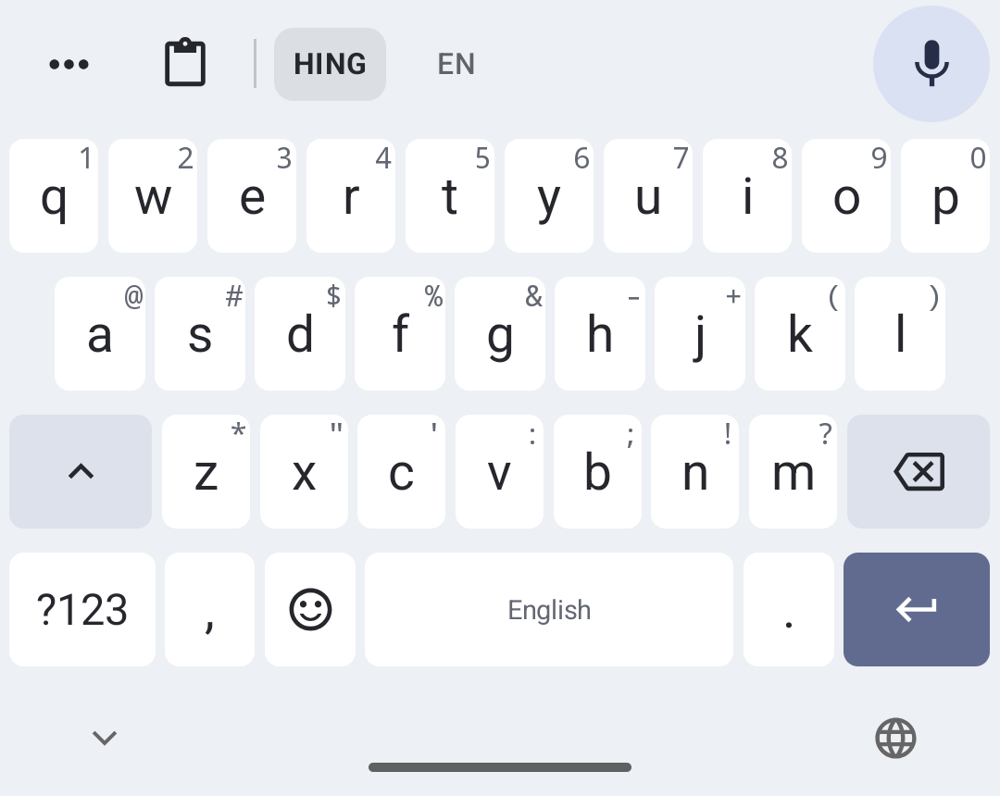
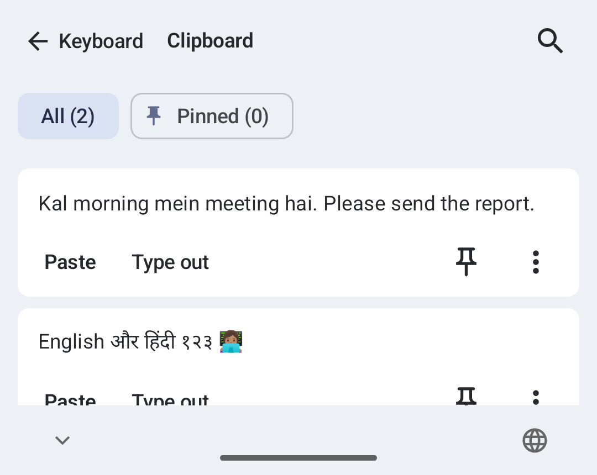

# Ayush Keyboard

Personal fork of Dictate Keyboard. The upstream keyboard, notices and licenses are retained.

## What changes

- Clipboard history is enabled on a fresh install. No age expiry, sensitive-item expiry or item-count eviction is enabled by default. Clearing Android’s primary clip does not delete stored history. Manual deletion and optional cleanup settings still work. Incognito behavior is retained.
- Tap a clipboard item to insert it normally through the keyboard connection. Open **Clipboard** and tap **Type out** under a text item to insert it one visible character at a time, 20 ms apart. A stop action appears while a clip is being typed. The **Keyboard** button returns to the keys; ordinary Paste follows the existing hide-on-paste preference. Switching fields, pressing a keyboard key or hiding the keyboard cancels it. It does not simulate hardware keys, and cannot guarantee acceptance by every editor. A failed insertion is not automatically retried, because a prefix may already have been accepted.
- Dictation defaults to the local provider; HING (mixed Hindi/English in English letters) and EN are the default modes. HING uses the dedicated Hindi2Hinglish-Apex model, while EN keeps the original Whisper Small model. Cloud rewriting is off by default. Offline setup offers Hinglish-Apex first and Whisper Small for English. Download the model once during setup; the APK does not contain hundreds of megabytes of model weights.
- Separate application ID (`dev.ayush.keyboard`, `.debug` for debug builds) allows installation alongside upstream Dictate. Display name: Ayush Keyboard.

## Build

Use Java 17+ and the Android SDK versions in `gradle/tools.versions.toml`. Set `JAVA_HOME` and `ANDROID_HOME` to your local installations.

```sh
bash tools/fetch-sherpa-onnx.sh
bash tools/bergamot/build-android.sh
./gradlew :app:assembleDebug
./gradlew :app:testDebugUnitTest --tests '*ClipboardTypeOutTest'
```

The Bergamot helper now supports macOS as well as Linux. Native libraries and downloaded models remain ignored build artifacts.

## Verification boundary

Recognition support for English and Hindi is not proof of accurate switching within a sentence. Accuracy, script choice, names, numbers, latency and battery use must be evaluated separately on real speech. See MODEL_RESEARCH.md for model selection and sources.

## Validation

- APK assembled successfully on macOS with Java 21 and Android SDK 36.
- Focused unit checks: 4 type-out tests and 20 model catalog tests passed.
- Android emulator: exact mixed English/Hindi/emoji insertion, interruption on field change, explicit password-field insertion, and history retention after system clipboard clear passed.
- Recognition runs with emulator networking disabled. See the model report for the actual transcripts and their limitations.
- The private, debug-only `ClipboardTestActivity` supplies a stable real editor for integration tests; it has no launcher entry and is absent from release builds.

Install the APK, enable **Ayush Keyboard** in Android keyboard settings, select it, and choose offline setup. Download Hinglish-Apex (~1.04 GB) for HING and Whisper Small (~376 MB) for EN. Both are already provisioned on the connected phone. Skip the optional floating-button/accessibility setup. Open the clipboard from the permanent toolbar; **Paste**, **Type out** and pinning are visible on each saved text clip.

## Keyboard UI

The keyboard uses matched light/dark themes with flat keycaps and a compact toolbar. The layout takes cues from Gboard's restrained toolbar/keycaps and SwiftKey's direct clipboard access. HING and EN are always visible; the dedicated mic sits at the right edge and becomes Stop while recording or processing. Occasional tools live under the three-dot menu. The suggestion/status row only occupies space while it has content.

Clipboard uses full-width text previews and visible Paste, Type out and pin actions. All/Pinned filters and search are available without a long press. Existing local history and manual deletion remain available. The one-time appearance migration sets the new theme pair; subsequent user theme changes are preserved.

Captured from the running emulator using synthetic clipboard content:





The UI integration check switches HING/EN, starts and discards a recording on the emulator, returns between keyboard and clipboard, pins a clip, and verifies Paste and Type out against a real Android field. It leaves the primary clipboard unchanged and deletes its own test entry. Android's virtual-node cache is cleared between panel queries so the check does not act on a stale view of the previous panel.

## Earlier engine and clipboard phone validation

The test APK was installed on the connected Samsung SM-S928B, running Android 16. All three device checks passed: Unicode type-out, real-editor clipboard/cancellation/history behavior, and local recognition. The physical-phone test restores the pre-test system clipboard in a finally block, removes its test history entry and does not run the Pixel-specific preview tap. Use `-e capturePreview true` only for the documented 1080 × 2400 emulator preview.

The keyboard was selected without enabling its accessibility service. Banking compatibility is separate from functional keyboard tests: iMobile showed a warning naming the separately installed TeamViewer app while Wispr accessibility was disabled.
