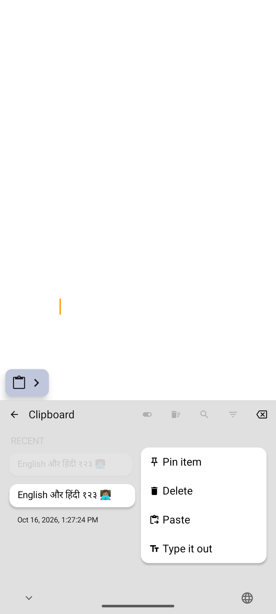

# Ayush Keyboard

Personal fork of Dictate Keyboard. The upstream keyboard, notices and licenses are retained.

## What changes

- Clipboard history is enabled on a fresh install. No age expiry, sensitive-item expiry or item-count eviction is enabled by default. Clearing Android’s primary clip does not delete stored history. Manual deletion and optional cleanup settings still work. Incognito behavior is retained.
- Tap a clipboard item to insert it normally through the keyboard connection. Long-press a text item and select **Type it out** to insert it one visible character at a time, 20 ms apart. A stop button appears in the clipboard header. Switching fields, pressing a keyboard key or hiding the keyboard cancels it. It does not simulate hardware keys, and cannot guarantee acceptance by every editor. A failed insertion is not automatically retried, because a prefix may already have been accepted.
- Dictation defaults to the local provider; English, Hindi and automatic detection are available in the language selector. Cloud rewriting is off by default. Offline setup offers multilingual Whisper Small first and Base second, independent of the phone’s UI language. Download the model once during setup; the APK does not contain hundreds of megabytes of model weights.
- Separate application ID (`dev.ayush.keyboard`, `.debug` for debug builds) allows installation alongside upstream Dictate. Display name: Ayush Keyboard.

## Build

Use Java 17+ and the Android SDK versions in `gradle/tools.versions.toml`. Set `JAVA_HOME` and `ANDROID_HOME` to your local installations.

```sh
bash tools/fetch-sherpa-onnx.sh
bash tools/bergamot/build-android.sh
./gradlew :app:assembleDebug
./gradlew :app:testDebugUnitTest --tests '*ClipboardTypeOutTest'
```

The Bergamot helper now supports macOS as well as Linux. Native libraries and downloaded models remain ignored build artifacts.

## Verification boundary

Recognition support for English and Hindi is not proof of accurate switching within a sentence. Accuracy, script choice, names, numbers, latency and battery use must be evaluated separately on real speech. See MODEL_RESEARCH.md for model selection and sources.

## Validation

- APK assembled successfully on macOS with Java 21 and Android SDK 36.
- Focused unit checks: 4 type-out tests and 20 model catalog tests passed.
- Android emulator: exact mixed English/Hindi/emoji insertion, interruption on field change, explicit password-field insertion, and history retention after system clipboard clear passed.
- Recognition runs with emulator networking disabled. See the model report for the actual transcripts and their limitations.
- The private, debug-only `ClipboardTestActivity` supplies a stable real editor for integration tests; it has no launcher entry and is absent from release builds.

Install the APK, enable **Ayush Keyboard** in Android keyboard settings, select it, and choose offline setup. Download multilingual Whisper Small once (~376 MB). Skip the optional floating-button/accessibility setup. Long-press a saved text clip for **Type it out**.

## Rendered clipboard

Captured from the running Android emulator with mixed English/Hindi test content.


